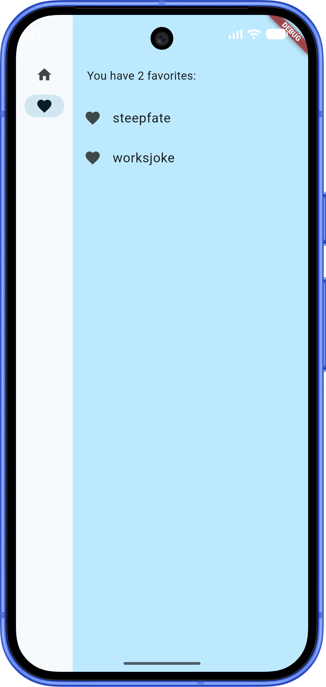
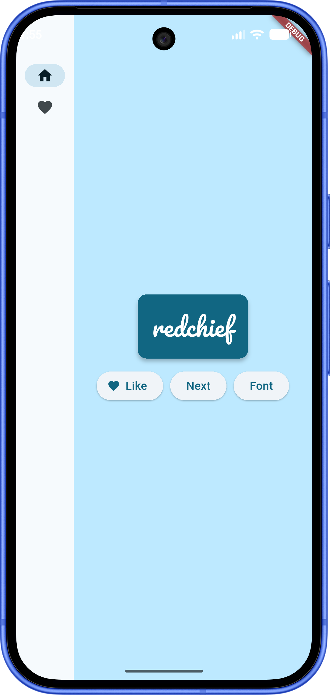

# Create Name (Namer App)

A responsive Flutter application that generates creative, unique-sounding names by combining random words. Users can generate new name suggestions, save their favorite combinations, customize typography fonts, and view their saved names on a dedicated favorites page.

---

## 📱 App Screenshots

| Home Screen | Favorites Screen |
| :---: | :---: |
|  |  |

---

## ✨ Features

- **Random Name Generation**: Instantly generate creative word pairs using the `english_words` package.
- **Favorites Management**: Like or unlike name suggestions and access them anytime on the dedicated Favorites page.
- **Interactive Font Customization**: Cycle through various Google Fonts to preview names in different typographic styles.
- **Responsive UI**: Adapts smoothly across mobile, tablet, desktop, and web viewports.
- **State Management**: Powered by `Provider` for clean, reactive state handling (`ChangeNotifier`).

---

## 🛠️ Tech Stack

- **Framework**: [Flutter](https://flutter.dev) (Dart 3.7+)
- **State Management**: [Provider](https://pub.dev/packages/provider)
- **Utilities**: [English Words](https://pub.dev/packages/english_words)
- **Typography**: [Google Fonts](https://pub.dev/packages/google_fonts)

---

## 🚀 Getting Started

### Prerequisites

Ensure you have the following installed on your machine:
- [Flutter SDK](https://docs.flutter.dev/get-started/install) (3.27+ recommended)
- Android Studio / VS Code with Flutter & Dart plugins
- An Android Emulator, iOS Simulator, or connected device.

### Installation & Running

1. **Clone or open the repository** in your IDE.
2. **Install dependencies**:
   ```bash
   flutter pub get
   ```
3. **Run the application**:
   ```bash
   flutter run
   ```

---

## 📂 Project Structure

```text
lib/
└── main.dart          # Main application entry point, UI views, and app state (NamerState)
android/               # Android platform-specific configuration and MainActivity.kt
ios/                   # iOS platform-specific configuration
web/                   # Web platform assets and index.html
pubspec.yaml           # App dependencies and asset configuration
```

---

## 👤 Author

- **Jessica Randall**

---

## 📜 License

This project is licensed under the MIT License.
